# 06-Practical Fruit and Citrus Object Detection Based on Yolo11

## 1. Data phase

### 1.1 Data Set Preparation

The Fruit Citrus Dataset is a dataset for target detection tasks. Its potential application areas include agriculture. As shown in the figure below:

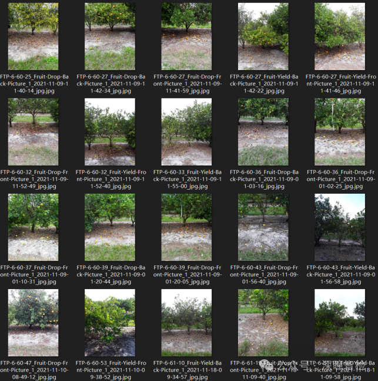

Dataset Introduction: The detection and counting of citrus fruits are key tasks in agricultural automation. This dataset aims to advance the technology of citrus detection and yield estimation by providing **high-resolution** images of citrus trees and high-quality bounding box annotations. It labels **on-tree (****ft****)** and **on-ground (****fg****)** fruits, comprising two categories for better estimation of yield.

The dataset consists of over 570 high-resolution images, covering citrus fruits both on and off the tree. The high resolution of the images allows for capturing the details of the fruits, making them suitable for training and testing deep learning models.

1.2 Data Set Structure Organization

The YOLO format dataset structure is as follows:

**citrus_fruit_dataset/******

**- train******

**-- images******

**-- labels******

**- test******

**-- images******

**-- labels******

The training set contains 460 jpg images, and the validation set consists of 119 jpg images.

### 1.3 Data Set Download

[Note: The prepared citrus_fruit_dataset folder should be in the same directory level as the following project, yolov11_det. Do not place the citrus_fruit_dataset folder inside the project.]

☆ You can directly obtain the converted Yolo format dataset (as shown in the following figure) by **seeing the end of this document**.

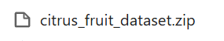

### 1.4 Environmental Installation

Execute the following instructions:

pip install ultralytics==8.3.59 -i https://pypi.tuna.tsinghua.edu.cn/simple

## 2. Training phase

### 2.1 Configuration File Modifications

[Prerequisites: CUDA, Torch, and Ultralytics versions must be compatible and available, using the Yolo11 M pre-trained model]

[Need to enter the project "yolov11_det"]

Modify the data configuration file ./custom.yaml, set the training and validation sets paths, ensure there is a consistent number of categories and category names.

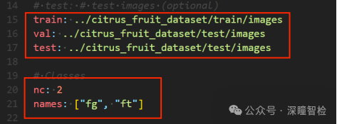

### 2.2 Execute Training Commands

Modify the training parameters in the train.py file as needed, such as: for Windows systems, set workers to 0; for Linux systems, set it to 8; other parameters should be modified according to hardware configuration requirements.

Execute training instructions:

python train.py

After training 200 epochs (with early stopping mechanism, 168 epochs), the model is saved in the runs/detect/train/weights folder.

### **2.3 Results Graph Display and Analysis**

1) F1_curve.png (F1 score)

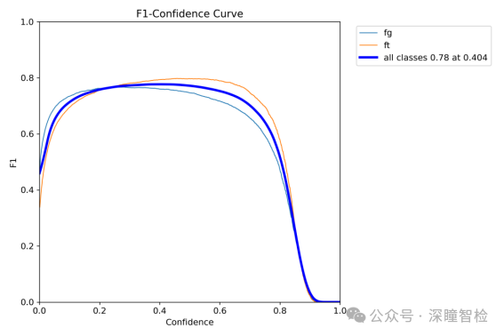

From the figure, when the confidence is 0.404, the F1 score of all classes is 0.78; indicating that the model performs well in predicting classes with a confidence level of 0.404, demonstrating certain accuracy and recall.

What is the F1 score? The F1 score is the harmonic mean of precision and recall, taking into account both the accuracy of model predictions and their coverage.

2) P_curve.png (Accuracy Curve)

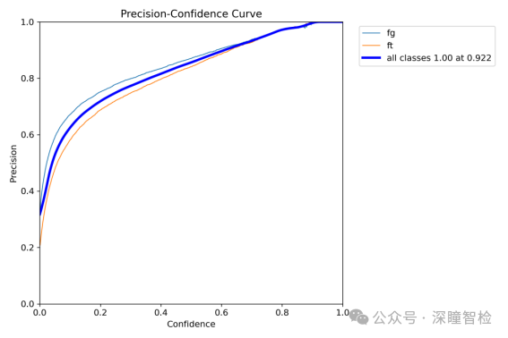

The deep blue line in the figure represents the overall accuracy, which increases with increasing confidence. At a confidence level of 0.922, the accuracy reaches 1.00. The other two lines represent the accuracy at different confidence levels for two categories respectively.

Precision curve, which helps analyze the model's performance in detection tasks, especially under different confidence settings. By this curve, a suitable confidence threshold can be selected to optimize the model's detection results, balancing precision and recall.

3) PR_curve.png (Precision-Recall curve)

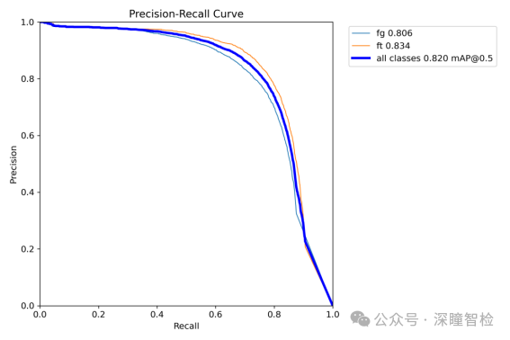

The curve in the image represents the Precision-Recall Curve (Precision-Recall Curve), which illustrates the precision and recall of the classifier at different thresholds. Specifically, the horizontal axis represents Recall (recall rate), ranging from 0.0 to 1.0; the vertical axis represents Precision (precision rate), ranging from 0.0 to 1.0. The main three curves in the image are:

(1) The color lines represent the precision-recall curve of two categories, with different precisions for each category.

(2) The deep blue line represents the average precision-recall curve for all categories, with precision also stabilizing around 0.820.

All three curves show a slight decrease in precision as recall increases, but overall precision remains at a very high level.

This curve can evaluate the overall performance of the model in the target detection task and find an appropriate confidence threshold to achieve the best balance between precision and recall. The closer the PR curve is to the upper right corner, the better the model performs, and the larger the area under the curve, indicating that the model performs more consistently across different confidence levels.

4) R_curve.png (Recall curve)

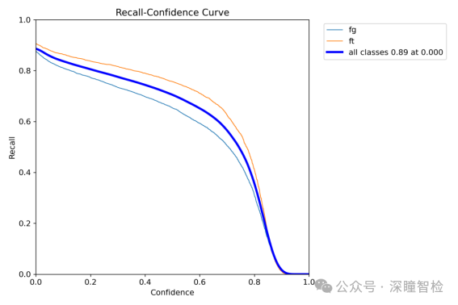

The R curve in the diagram represents the Recall-Confidence Curve (Recall-Confidence Curve), which shows the recall rate at different confidence levels. Specifically, the horizontal axis represents confidence levels, ranging from 0.0 to 1.0; the vertical axis represents recall rates, ranging from 0.0 to 1.0. The main three curves in the diagram are:

(1) Two color lines: Recall rates for two categories as a function of confidence. This curve shows that the recall rate for each category changes little with increasing confidence, then drops sharply after a certain point.

(2) Deep blue line: Represents the average recall rate of all categories as a function of confidence.

Display the recall performance of the model under different confidence thresholds. The recall curve aids in evaluating the model's ability to detect true targets in a target detection task. By analyzing this curve, users can assess the model's detection capabilities and analyze whether the model is comprehensively detecting true targets at varying thresholds. If the recall curve performs well at lower confidence levels, it indicates that the model can effectively detect most targets; if the curve declines rapidly, adjustments to the model or dataset may be necessary to avoid missed detection issues.

5) results.png (results indicator curve)

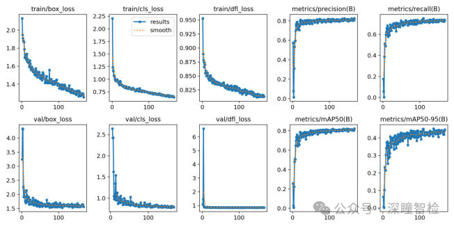

This image file shows the trend of key metrics (such as loss, mAP) during training.

box_loss: Position loss curve

Meaning: Bounding box loss, measuring the error between the predicted bounding box and the true one. Includes center position, width, height, etc.

Chart: Typically displays the loss value curve on training rounds or steps, with lower values indicating more accurate predictions of bounding boxes by the model.

dfl_loss: Target Detection Loss Curve

Meaning: Distribution Focal Loss, which addresses the issue of class imbalance in positioning tasks and helps models focus more on difficult-to-predict targets.

Chart: Shows the loss value curve for training epochs or steps, with lower values indicating better performance in distributed positioning tasks.

cls_loss: Classification Loss Curve

Meaning: Category loss, measuring the gap between predicted class labels and true class labels. Reflects the accuracy of the classifier.

Chart: Shows the loss value curve for training epochs or steps, with lower values indicating better classification performance.

Precision (B): Precision curve

Meaning: Precision (B-class), indicating how many proportion of true positives are predicted by the model. B-class usually refers to background class.

Chart: Shows the precision curve on training rounds or steps, with higher precision indicating higher accuracy in background class detection.

Recall (B) Curve

Meaning: Recall rate (B-class), which represents the proportion of actual positive samples detected by the model. B-class usually refers to background classes.

Chart: Shows recall curves on training epochs or steps, with higher recall indicating stronger detection capabilities of the model for background classes.

mAP50 (B): Average Precision when IoU threshold is 0.5

Mean Accuracy (B-class) at IoU threshold of 0.5, reflects the model's accuracy at this IoU threshold.

Chart: Shows the mAP50 value curve on training epochs or steps, with higher mAP50 values indicating higher detection accuracy of background classes by the model.

mAP50-95 (B): The average precision between 0.5 and 0.95 for IoU thresholds

Mean accuracy (B-class) within the range of IoU thresholds from 0.5 to 0.95, evaluating the detection performance of models under different IoU thresholds.

Chart: Shows the mAP50-95 value curve on training epochs or steps, with higher mAP50-95 values indicating stronger overall performance of the model on background classes.

## 3. Inference phase

### 3.1 Starting the Inference

Predict using the trained model (input test image folder input_test_images):

Execute the following instructions:

python predict.py

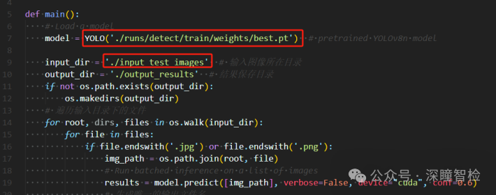

After the test is completed, the results are saved in the output_results folder.

### 3.2 Output Display

Output:

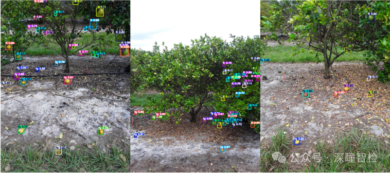

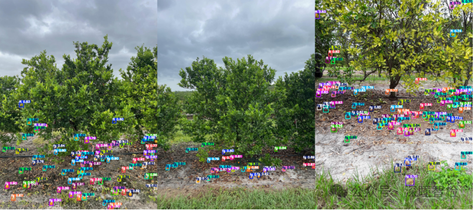

## Payment

Here is a pay link on Stripe ( https://buy.stripe.com/3cs8yP7sY87d0vu9AB ). Please contact me lonlonago@foxmail.com after funding $89, and I will send you a complete data files , thank you!

